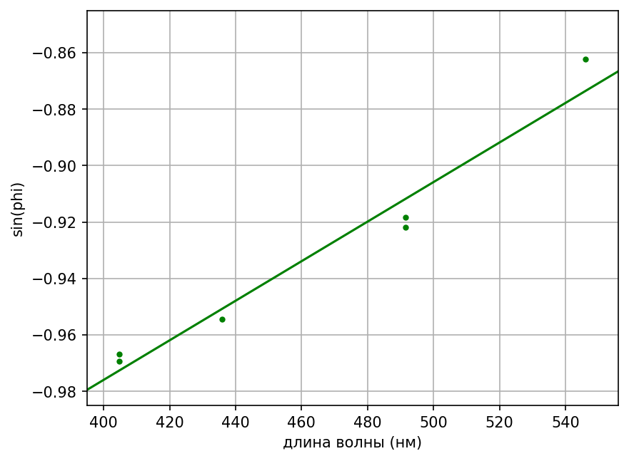

# Lab Helper

Python helpers for turning Excel lab measurements into plots, linear fits, and LaTeX tables. Values and their uncertainties can be carried together through the calculations.

## Run the example

Run these commands from the repository root.

```bash
python -m pip install numpy pandas openpyxl uncertainties matplotlib
python example.py
```

The example reads the [included Excel workbook](lab4.4.2.xlsx), prints measurement rows in LaTeX, and fits a line to the sine of the measured angle versus wavelength. It plots the selected points with error bars. The preview focuses on the measured wavelengths.



## Use the helpers in your own lab

| Task | Function |
| --- | --- |
| Read a measurement column and an uncertainty column from Excel | `get_ufloat_arr_from_excel(file, sheet, value_column, error_column)` |
| Get numbers and error bars for Matplotlib | `get_values_and_errs_from_ufloat_arr(values)` |
| Fit a line with an intercept | `mnk(x, y)` |
| Fit a line through the origin | `mnk_linear(x, y)` |
| Print measurement rows for a LaTeX table | `make_table_and_print(0, len(values), values)` |

The Excel reader returns an array of `ufloat` values from the `uncertainties` package. Arithmetic propagates the measurement uncertainties. Use matching array lengths for fits and tables, and use a column of zeros when a measurement column has no recorded uncertainty.

See [example.py](example.py) for a complete example showing the imports, the workbook columns, and the calculation.
